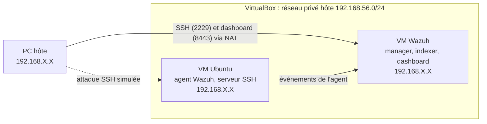

# Lab SOC Wazuh : détection d'attaques et réponse active

Lab personnel de cybersécurité : un serveur **Wazuh** (SIEM/XDR) déployé sur VirtualBox surveille une machine Ubuntu via un agent. J'y simule des attaques courantes, j'analyse les alertes générées, j'écris une règle de détection personnalisée et je configure une réponse automatique.
> Toutes les attaques sont simulées dans mon propre environnement isolé.

## Objectifs

- Déployer une plateforme SIEM/XDR dans un réseau virtuel isolé
- Surveiller une machine Linux avec un agent Wazuh
- Simuler des attaques et analyser les alertes (gravité, règle, technique MITRE ATT&CK)
- Écrire une règle de détection personnalisée
- Automatiser une réaction : bloquer l'adresse d'un attaquant

## Architecture

Détails : [docs/01-architecture.md](docs/01-architecture.md)

## Technologies

Wazuh 4.14.7 (OVA) · VirtualBox · Ubuntu 23.10 · SSH · iptables · MITRE ATT&CK

## Mini-labs réalisés

| # | Scénario | Résultat | Détail |
|---|---|---|---|
| 1 | Surveillance d'intégrité de fichiers (FIM) | Alerte sur modification, ajout et suppression de fichier, avec le contenu modifié | [lab1-fim](docs/labs/lab1-fim.md) |
| 2 | Force brute SSH (T1110) | Chaîne d'alertes avec escalade jusqu'au niveau 10 | [lab2-force-brute-ssh](docs/labs/lab2-force-brute-ssh.md) |
| 3 | Usage de `sudo` | Alertes sur les usages et échecs de `sudo` | [lab3-usage-sudo](docs/labs/lab3-usage-sudo.md) |
| 4 | Règle de détection personnalisée | Gravité d'un fichier critique relevée de 7 à 12 | [lab4-regle-personnalisee](docs/labs/lab4-regle-personnalisee.md) |
| 5 | Réponse active | Adresse de l'attaquant bloquée par une règle iptables | [lab5-reponse-active](docs/labs/lab5-reponse-active.md) |

Un rapport d'incident complet sur la force brute SSH est disponible : [rapport-incident-force-brute](docs/rapport-incident-force-brute.md).

## Compétences mises en pratique

- Virtualisation et réseau : NAT, redirection de ports, réseau privé hôte
- Administration Linux : services (`systemctl`), journaux, `iptables`
- Détection : lecture d'alertes, niveaux de gravité, MITRE ATT&CK
- Ingénierie de détection : écriture et test d'une règle personnalisée
- Réponse à incident : réponse active, rapport d'incident
- Dépannage méthodique et documentation

## Difficultés rencontrées

- **Réseau NAT de VirtualBox** : le port ne s'ouvrait jamais. Diagnostic par les processus VirtualBox, puis passage au NAT simple : [reseau-nat-virtualbox](docs/depannage/reseau-nat-virtualbox.md)
- **Disque plein sur le serveur Wazuh** : le manager ne redémarrait plus. Cause remontée avec `df` et `du` : [disque-plein](docs/depannage/disque-plein.md)

## Limites et évolutions

- Détection de vulnérabilités désactivée (disque de 25 Go insuffisant) : à reprendre avec plus de stockage
- Agent Windows : collecte des journaux d'événements Windows
- Visibilité réseau : journaux d'un pare-feu (pfSense) ou d'un IDS (Suricata) remontés dans Wazuh

## Documentation

- [Architecture](docs/01-architecture.md)
- [Installation](docs/02-installation.md)
- [Démarrage du lab](docs/03-demarrage-du-lab.md)
- [Glossaire](docs/glossaire.md) · [Commandes utiles](docs/commandes-utiles.md)
