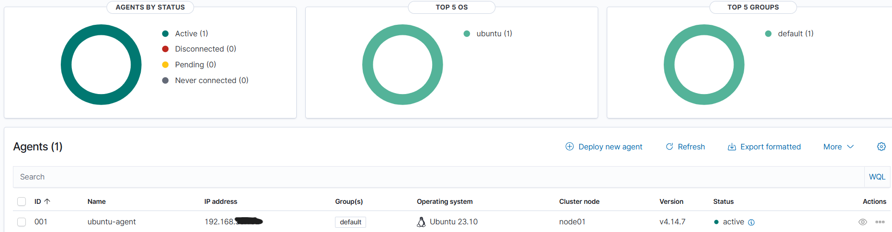

# Architecture du lab
## Vue d'ensemble

Le lab repose sur deux machines virtuelles VirtualBox qui communiquent par un réseau privé isolé. Un PC hôte joue à la fois le rôle d'administrateur et celui d'attaquant simulé. Le schéma d'ensemble figure dans le [README](../README.md#architecture).

## Composants

| Machine | Rôle | Logiciels |
|---|---|---|
| VM Wazuh | Serveur de sécurité | OVA Wazuh 4.14.7 : manager, indexer, dashboard |
| VM Ubuntu | Machine surveillée | Ubuntu 23.10, agent Wazuh, serveur SSH |
| PC hôte | Administration et attaque simulée | VirtualBox, client SSH, navigateur |

Les trois composants de Wazuh se répartissent le travail :

- **Manager** : reçoit les événements des agents et les compare aux règles de détection.
- **Indexer** : stocke et indexe les alertes.
- **Dashboard** : interface web de consultation et de recherche.

## Réseau

| Machine | Carte 1 | Carte 2 |
|---|---|---|
| VM Wazuh | NAT (redirections de ports) | Réseau privé hôte |
| VM Ubuntu | Réseau privé hôte | NAT (accès internet) |

| Réseau | Plage | Usage |
|---|---|---|
| Réseau privé hôte | 192.168.56.0/24 | Communication entre le PC et les deux VM (agent vers manager, attaque simulée) |
| NAT | Attribuée par VirtualBox | Accès internet des VM et redirections de ports vers Wazuh |

Les adresses des VM sont attribuées par DHCP. Elles peuvent changer après un redémarrage et doivent être vérifiées avec `ip -4 a`.

### Redirections de ports (carte NAT de la VM Wazuh)

| Nom | Protocole | Hôte | Port hôte | Port invité | Usage |
|---|---|---|---|---|---|
| ssh | TCP | 127.0.0.1 | 2229 | 22 | Administration en ligne de commande |
| dashboard | TCP | 127.0.0.1 | 8443 | 443 | Accès à l'interface web : `https://127.0.0.1:8443` |

L'adresse 127.0.0.1 limite l'accès à ces ports au PC hôte.

## Choix de conception

- **Deux cartes par machine** : le réseau privé hôte permet au PC et aux VM de se joindre entre eux, tandis que le NAT donne l'accès internet (téléchargement de l'agent) sans exposer les VM.
- **NAT simple avec redirections plutôt que Réseau NAT** : le Réseau NAT de VirtualBox n'ouvrait pas les ports sur cette installation. Voir [le dépannage](depannage/reseau-nat-virtualbox.md).
- **Attaque depuis le PC hôte** : l'attaque arrive par le réseau privé hôte, comme un attaquant externe, et l'agent d'Ubuntu observe ses effets dans les journaux du système.

## Vérification : agent connecté

Le dashboard Wazuh affiche l'agent `ubuntu-agent` au statut **Active** : il est enregistré auprès du serveur et lui envoie ses événements.

