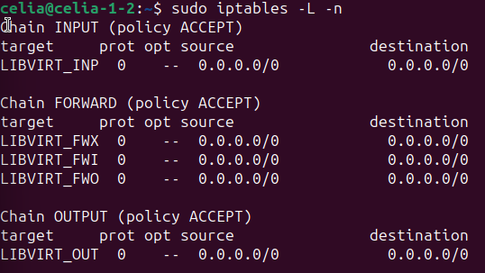
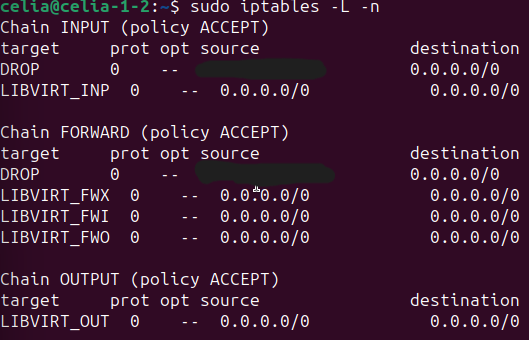

# Lab 5 : réponse active (blocage automatique d'un attaquant)

## Objectif

Passer de la **détection** à la **réaction**. Lors du [lab 2](lab2-force-brute-ssh.md), Wazuh alerte sur la force brute SSH mais ne bloque rien. La réponse active (*active response*) ordonne à l'agent d'exécuter une action lorsqu'une règle se déclenche. Ici : bloquer l'adresse de l'attaquant dans le pare-feu d'Ubuntu pendant 3 minutes.

## Principe

| Élément | Rôle | Valeur dans le lab |
|---|---|---|
| Commande | Script exécuté par l'agent | `firewall-drop` (bloque une adresse avec `iptables`) |
| Déclencheur | Règle qui lance l'action | Règle 5763 (force brute SSH, niveau 10) |
| Emplacement | Machine où l'action s'exécute | `local` : la machine qui a généré l'alerte (Ubuntu) |
| Durée | Temps avant retrait automatique | 180 secondes |

## Prérequis vérifiés

- **Serveur** : la section `<active-response>` de `ossec.conf` ne contenait qu'un exemple en commentaire : aucune réponse active n'était configurée. La commande `firewall-drop` était en revanche déjà déclarée (avec `<timeout_allowed>yes</timeout_allowed>`).
- **Agent Ubuntu** : `iptables` est installé et le script `/var/ossec/active-response/bin/firewall-drop` est présent.

```
sudo grep -n -A8 "active-response" /var/ossec/etc/ossec.conf
sudo grep -n "firewall-drop" /var/ossec/etc/ossec.conf
which iptables
```

Les deux premières commandes s'exécutent sur le serveur, la troisième sur Ubuntu.

## Configuration (sur le serveur Wazuh)

### 1. Sauvegarder

```
sudo cp /var/ossec/etc/ossec.conf /var/ossec/etc/ossec.conf.bak2
```

### 2. Ajouter le déclencheur

Le bloc est dans [configs/active-response.xml](../../configs/active-response.xml). Il doit se placer **avant** la dernière ligne du fichier (`</ossec_config>`). La commande `sed` ci-dessous l'y insère (`$i\` insère avant la dernière ligne) :

```
sudo sed -i '$i\  <active-response>\n    <command>firewall-drop</command>\n    <location>local</location>\n    <rules_id>5763</rules_id>\n    <timeout>180</timeout>\n  </active-response>' /var/ossec/etc/ossec.conf
```

### 3. Vérifier, tester, redémarrer

```
sudo tail -n 10 /var/ossec/etc/ossec.conf
sudo /var/ossec/bin/wazuh-analysisd -t; echo "code: $?"
sudo systemctl restart wazuh-manager
```

Le bloc était présent avant `</ossec_config>`, le test a renvoyé `code: 0` et le manager a redémarré (`active (running)`).

## Test

### État initial du pare-feu d'Ubuntu

```
sudo iptables -L -n
```

### Attaque depuis le PC hôte

Plusieurs tentatives de connexion SSH avec de mauvais mots de passe, comme au [lab 2](lab2-force-brute-ssh.md) :

```
ssh celia@192.168.56.102
```

| Phase | Observation |
|---|---|
| Début des essais | Demande du mot de passe, puis `Permission denied` |
| Après plusieurs échecs | Connexion coupée en cours d'essai : `ssh_dispatch_run_fatal: Connection ... timed out` |
| Ensuite | `ssh: connect to host 192.168.56.102 port 22: Connection timed out` : Ubuntu ne répond plus au PC |

### Preuve du blocage

```
sudo iptables -L -n
```

Relevé du pare-feu d'Ubuntu avec `sudo iptables -L -n`, avant puis après l'attaque :

| Avant l'attaque | Après l'attaque |
|---|---|
|  |  |

Après l'attaque, une règle **DROP** visant l'adresse du PC hôte (masquée sur la capture) apparaît dans les chaînes `INPUT` et `FORWARD`. Les chaînes `LIBVIRT_*` proviennent de l'installation d'Ubuntu et ne sont pas liées à Wazuh.

Chaîne complète : mauvais mots de passe, alertes SSH, règle 5763, ordre du manager, exécution de `firewall-drop` par l'agent, règle `iptables`.

La durée du blocage est fixée à 180 secondes dans la configuration (`<timeout>180</timeout>`), et la commande `firewall-drop` déclare `<timeout_allowed>yes</timeout_allowed>`. Le retrait automatique n'a pas été mesuré dans ce lab : sa vérification (journal `/var/ossec/logs/active-responses.log` ou relevés `iptables` horodatés) fait partie des améliorations possibles.

## Limites et précautions

- Une réponse active mal réglée peut bloquer un utilisateur légitime (faux positif). La durée limitée évite de se couper définitivement de la machine.
- Un blocage par adresse IP est contourné par un attaquant qui change d'adresse.
- En production, on teste d'abord la règle en simple alerte, puis on active la réponse sur un périmètre restreint.
- Référence : documentation officielle de Wazuh, « Blocking SSH brute-force attack with Active Response ».
